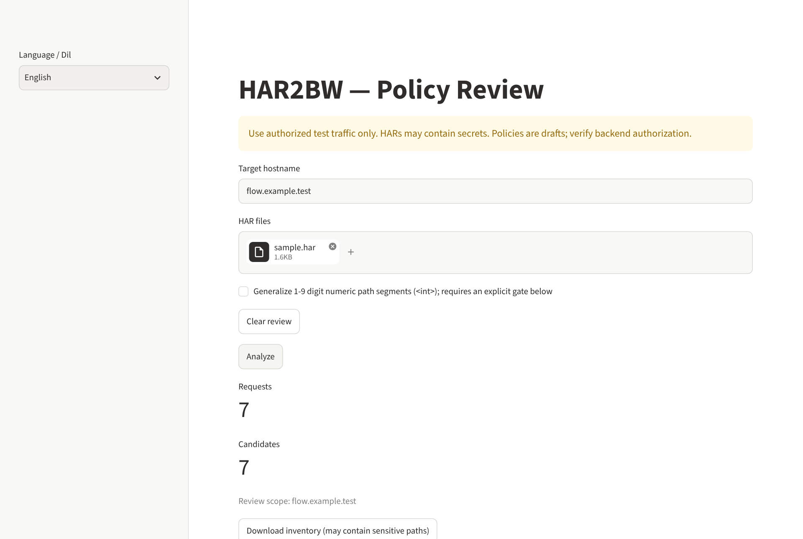
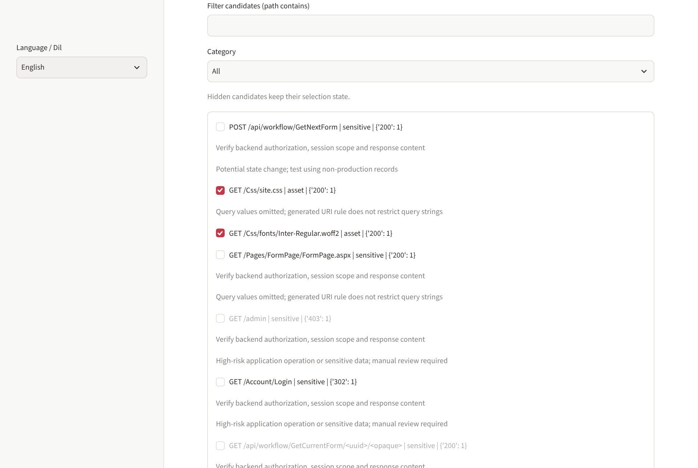
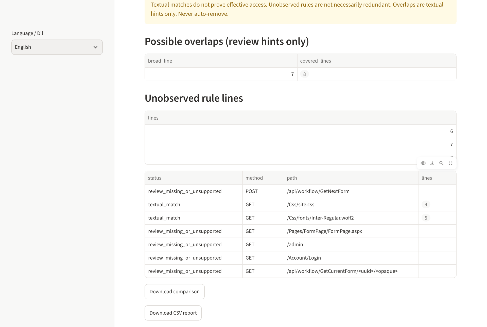
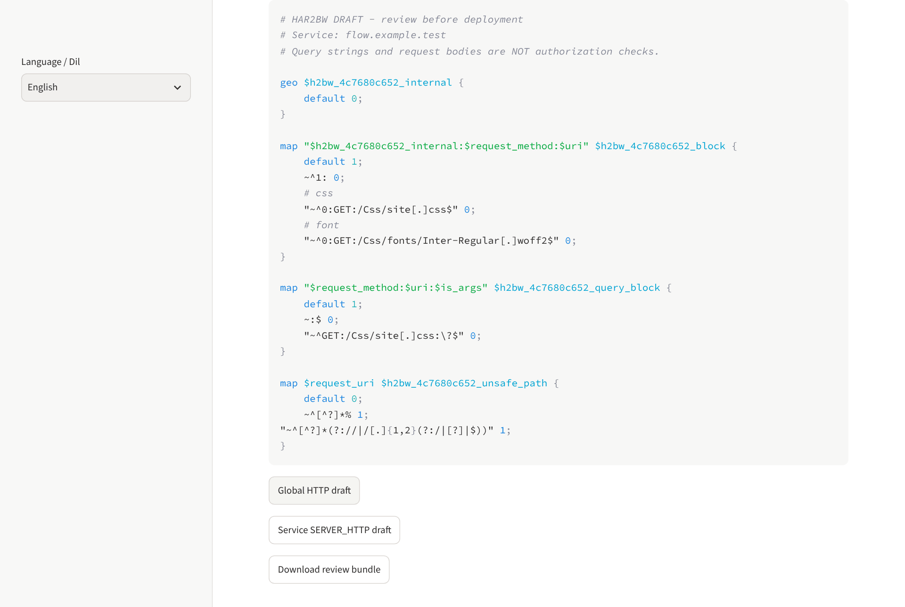

# HAR2BW 1.2.0

Local HAR inventory, explicit review, and default-deny BunkerWeb policy drafts.
Python 3.11+; CLI uses the standard library. The web UI needs `requirements.txt`.
No automatic deployment, reload, rule deletion, or WAF disabling.

## Screenshots

Local review UI with the synthetic `sample.har` (host `flow.example.test`); no real traffic or customer data.

**1. Analyze HAR files.** Upload one or more HARs for an exact hostname and get the request and candidate counts.



**2. Review candidates.** Filter by path or category; every candidate shows its warnings, and sensitive or high-risk ones need explicit gates.



**3. Compare with an existing configuration.** Offline, textual comparison: overlaps, unobserved rules and observations. Hints only; nothing is removed automatically.



**4. Generate a default-deny draft.** Method-scoped NGINX maps plus query and unsafe-path guards, exported as a review bundle. Nothing is deployed.



## Scan and generate

Capture authorized synthetic traffic in DevTools. Keep customer HAR files outside
Git. Analyze one or more HARs for one exact DNS hostname:

```sh
python har2bw.py scan --host flow.example.test sample.har --out review
```

Review `review/report.json`. In `review/approve.json`, populate `approved_ids`
with only the reviewed candidate IDs. Preserve `schema_version`, `host` and
`report_sha256`. Empty approvals cannot generate policies. Changes to the derived
inventory invalidate approval; re-scan and review rather than editing its digest.
Legacy bare ID arrays are intentionally rejected by generation in v1.

```sh
python har2bw.py generate --host flow.example.test sample.har \
  --approve review/approve.json --out policy
python har2bw.py --version
```

Outputs are two NGINX drafts, the bound approval and a checksum manifest, created
in a fresh owner-only directory with owner-only files. The manifest detects
accidental changes; it is not a digital signature. Downloads from the browser
inherit your browser's filesystem permissions.

Review gates are explicit: `--allow-sensitive`, `--allow-dynamic`, `--allow-numeric`,
`--allow-redirect-only`, and `--allow-unrestricted-query`. Query strings are denied
by default, including for static assets. The query flag permits arbitrary query
values only for approved method/path candidates observed with queries. It does
not validate query parameters or bodies. UUID patterns cover other objects and
require backend object authorization. Numeric segments (including short IDs) and
opaque/unsafe paths are redacted and cannot generate rules by default.

Optional, opt-in generalization (v1.1): `--numeric-ids` (scan and generate) turns
1-9 digit path segments into an `<int>` pattern (`[0-9]{1,9}`) that covers *other*
objects, so generation also requires `--allow-numeric` and backend object-level
authorization. Longer numbers stay opaque. The option is recorded in the report,
so approvals made with it are invalid without it. `nginx_review.py` and
`policy_diff.py` accept the same `--numeric-ids` flag.

`--risk-terms FILE` (scan, generate and the comparison tools) takes a JSON array of
extra lowercase path fragments that add the manual-review warning, e.g.
`["/payroll", "/export"]`. Built-in terms (`upload`, `download`, `export`, `token`,
`password`, `/admin`, `/account/`, `/oauth/`) cannot be removed; terms only add
warnings and never relax a gate.

Internal CIDR bypass is optional. `--internal CIDR` additionally requires
`--confirm-trusted-real-ip`; verify trusted proxy ranges and spoofed client-IP
headers in staging. Catch-all networks are rejected. Query and raw-path guards
still apply to internal clients. This never bypasses BunkerWeb's WAF protections.

## Local review UI

```sh
python -m venv .venv
. .venv/bin/activate
pip install -r requirements.txt
streamlit run web.py
# Or: docker compose up --build
```

Open `http://127.0.0.1:8501`. Upload multiple HARs, analyze, inspect risks, select
individual candidates, acknowledge applicable gates, and export a review ZIP.
Changing hostname or HAR content invalidates the previous review and draft.
Upload an existing HTTP config to inspect textual matches, missing/unsupported
observations, unobserved rules and duplicate rule groups. No uploaded config is
executed. Clear the review and close the browser session after use. The UI is
single-user and must not be publicly exposed; CORS/XSRF remain enabled.

## Compare policies

```sh
python nginx_review.py --host flow.example.test --config existing.conf sample.har
python policy_diff.py --host flow.example.test \
  --previous old-approve.json --proposed review/approve.json sample.har
```

The parser recognizes a conservative subset of line-oriented NGINX maps, never
executes arbitrary regexes/includes, and reports unknown lines. Matches describe
text, not effective access: map order, includes, guard wiring and other controls
must be reviewed separately. Unobserved and duplicate rules are review candidates,
never proof that deletion is safe. Approval-set comparison also accepts legacy
ID arrays for historical review; generation does not.

## Optional read-only API snapshot

`bunkerweb_api.py` reads an explicitly named HTTP snippet over verified HTTPS.
Use a least-privilege read token via `HAR2BW_API_TOKEN`, not command-line arguments.
It checks the target OpenAPI for the config GET contract, rejects redirects,
disables ambient HTTP proxies, bounds response size and stores a private snapshot.
Use `--ca-file` for a private CA; there is no insecure TLS mode.

```sh
python bunkerweb_api.py --url https://waf-api.example.test \
  --service flow.example.test --type server_http --name allowlist --out snapshots/review
```

Only GET requests are implemented. The response wrapper is retained as JSON for
manual inspection; a snippet snapshot is not a complete rollback backup. No live
endpoint was contacted during development. Contract reference:
[BunkerWeb API](https://docs.bunkerweb.io/latest/api/).

Comparison output also lists `possible_overlaps`: a rule with an `<uuid>`/`<int>`
pattern that textually matches another listed rule with an overlapping method. It
is a review hint, not proof of redundancy; unrecognized syntax is never matched.

## Reports, history, rollback plan, projects (v1.2)

All of these are local and offline. None of them deploys, reloads or changes a WAF.

- **CSV/PDF reports:** `python reporting.py --host H --format csv|pdf [--lang tr] --out NEWDIR har...`
  (also buttons in the UI). CSV cells that start with `=`, `+`, `-` or `@` are
  neutralized against spreadsheet formula injection. The PDF is a dependency-free,
  text-only file (no scripts or links); Turkish letters are folded to ASCII there.
  Reports contain paths: treat them as customer data.
- **Project history:** set `HAR2BW_WORKSPACE` to a private directory. A project is
  `<workspace>/<name>/history` (`[a-z0-9-]`, max 40). `python history.py --project P
  save|list|verify|diff` stores each reviewed bundle as an append-only, read-only
  version with a checksum chain; `verify` detects edited files and a missing parent.
  This detects accidents, it is not a signature. The UI can save a generated bundle
  to the selected project. The workspace is git-ignored; never commit it. In Docker
  the filesystem is read-only: mount a private volume and set the variable yourself.
- **Rollback plan (not an engine):** `python rollback_plan.py --workspace W --project P
  --version V --snapshot snapshot.json` compares a verified known-good draft with a
  read-only API snapshot and prints manual steps. Applying anything remains an
  operator action in staging first.
- **Optional UI password:** set `HAR2BW_UI_PASSWORD` (12+ characters). It is a single
  shared password with a 5-attempt limit per session, not a user system. Keep the UI on
  loopback or behind your own authenticating reverse proxy with TLS.
- **Language:** the UI language selector (English/Türkçe) is in the sidebar.
- **UI review aids:** comparison tables, candidate filter, previous-approval compare.

## Install as commands (optional)

```sh
pip install .            # or: pip install '.[ui]' for the review UI
har2bw --version         # also: har2bw-review, har2bw-diff, har2bw-snapshot,
                         # har2bw-history, har2bw-rollback-plan, har2bw-report
```

## Known limitations

- A HAR shows only what was exercised; it cannot reveal paths nobody visited, and a
  2xx response does not prove the user was authorized. Backend checks remain essential.
- Query strings, request bodies and headers are never validated by generated rules.
- UUID and `<int>` patterns cover objects other than those observed.
- WebSocket frames, server-sent events and non-HTTP traffic are not analyzed.
- Paths that need encoded characters, repeated slashes or dot segments are denied.
- The NGINX parser understands only the line-oriented maps this tool generates;
  everything else is reported as unknown, never as access or redundancy.
- HARs up to 128 MiB per run are read into memory; split very large captures.
- v1.1 behavior was validated with unit, UI and loopback NGINX tests; the isolated
  BunkerWeb staging/rollback evidence in docs/staging-validation.md covers v1.0.0.

## Validation and deployment

```sh
python -m unittest discover -v
python test_nginx.py  # installed NGINX, ephemeral loopback listener only
```

CI runs Python 3.11–3.13, real NGINX checks, UI tests, dependency audit, static
security checks, a gitleaks history scan and repository hygiene tests, Docker health/non-root checks, and isolated BunkerWeb 1.6.18
staging/rollback checks. See [staging validation](docs/staging-validation.md). See
[deployment and rollback](docs/deployment.md) before manual staging validation.

HAR reports and configs remain sensitive: headers, cookies, bodies and query
values are omitted, but arbitrary short text identifiers cannot be reliably
anonymized. Treat every artifact as customer data. Successful responses do not
establish authorization. Encoded paths, repeated slashes and dot-segment aliases
are denied; applications that require those paths need separate manual design.
